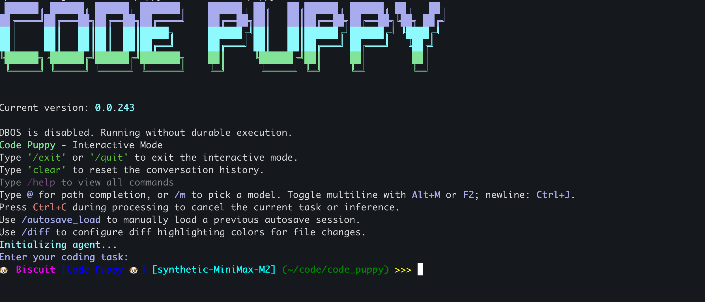

<div align="center">



**🐶✨The sassy AI code agent that makes IDEs look outdated ✨🐶**

[](https://pypi.org/project/code-puppy/)
[](https://python.org)
[](LICENSE)
[](https://github.com/pydantic/pydantic-ai/tree/main/src/pydantic_ai_pax)
[](#code-puppy-privacy-commitment)

[](https://github.com/mpfaffenberger/code_puppy/stargazers)
[](https://github.com/mpfaffenberger/code_puppy/network)
[](https://discord.gg/eAGdE4J7Ca)

<br>


</div>

---

## What is Code Puppy 1.0?

**Code Puppy 1.0 is an opinionated distribution built on [Pydantic AI Pax](https://github.com/pydantic/pydantic-ai/tree/main/src/pydantic_ai_pax)** (powered by [`pydantic-ai-harness`](https://pydantic.dev/docs/ai/harness/) and [`pydantic-ai`](https://ai.pydantic.dev/))—combining Pax's agent runtime, terminal/web UI, sessions, MCP, and sandboxes with Code Puppy's personality, theme, batteries-included extras, and pre-installed plugins.

> **Looking for Code Puppy 0.0.x?** It's still on PyPI: `uvx --from 'code-puppy<1' code-puppy`.
> See [`docs/upgrade/code_puppy_1_0_rewrite_plan.md`](docs/upgrade/code_puppy_1_0_rewrite_plan.md) for rewrite details and status.

## Quick Start

Requires **Python 3.11–3.14** and [`uv`](https://docs.astral.sh/uv/).

```bash
# Run directly without installing
uvx code-puppy

# Or install globally (gives you both `pup` and `code-puppy`)
uv tool install code-puppy
pup
```

<details>
<summary>Don't have <code>uv</code> yet?</summary>

**macOS / Linux:**

```bash
curl -LsSf https://astral.sh/uv/install.sh | sh
```

**Windows (PowerShell):**

```powershell
powershell -ExecutionPolicy ByPass -c "irm https://astral.sh/uv/install.ps1 | iex"
```

> **Windows note:** The agent executes shell commands in PowerShell via Pax's `WindowsWorkspace`.

</details>

## Logging In & Choosing Models

Start `pup` and run `/login` to open the sign-in picker, or connect a provider directly:

| Provider | Command | Notes |
|---|---|---|
| **OpenAI Codex** (ChatGPT subscription) | `/login codex` | Alias for `/login openai-codex`; adds available Codex models |
| **Claude Code** (Claude subscription) | `/login claude-code` | Powered by the bundled `claude_code` plugin (`claude-code:` models) |
| **GitHub Copilot** | `/login copilot` | Alias for `/login github-copilot`; adds every model your account serves |
| **OpenRouter** | `/model add` → **OpenRouter** → **OAuth** | You can also enter an API key instead of using browser OAuth. |

- **Switch models:** Run `/model` (or `/model add` to add any provider/model).
- **Use API keys directly:** Run `/keys` to store keys securely in your OS keyring, or export standard environment variables (`ANTHROPIC_API_KEY`, `OPENAI_API_KEY`, `GEMINI_API_KEY`, `OPENROUTER_API_KEY`, etc.) or put them in a local `.env` file.
- **Multiple accounts:** Append `@<profile>` to sign in to more than one account—for example `/login codex@work` or `/login claude-code@personal`—then select `PROVIDER@PROFILE:MODEL`.

## Setting Custom Rules (`/system_prompt` & `AGENTS.md`)

### Global personal rules with `/system_prompt`

Run `/system_prompt` inside a session to open the system prompt menu:

- **Your instructions (`Edit…`)** — Opens a multi-line editor for your personal rules (stored in the `run.instructions` setting). Clearing it restores the defaults.
- **Append to yours (`Append…`)** — Adds a new paragraph to the end of your existing instructions.
- **Full system prompt (`View…`)** — Read-only view of the exact system prompt last sent to the model.

Your custom instructions are **appended** after Pax's built-in instructions, the repo's `AGENTS.md`, and plugin instructions (such as `personality`), and take effect on your very next prompt.

### Project rules with `AGENTS.md`

Drop an `AGENTS.md` file in your repository root to share coding standards, architecture notes, and commands with everyone working on that repo. Code Puppy loads it automatically.

> **Tip:** Want to rename your puppy/owner or tone down the sass? Run `/plugins configure personality` to change names, or `/plugins disable personality` for a plain agent.

## What Code Puppy Adds on Top of Pax

- **Code Puppy Identity & Theme** — Custom banner, color palette, animated startup splash (set `CODE_PUPPY_NO_SPLASH=1` to skip), and a one-time first-launch prompt to name your puppy and tell it who its owner is.
- **Every Pax Extra Pre-Installed** — Ships with all ten `/sandbox` providers (`boxd`, `daytona`, `e2b`, `kubernetes`, `modal`, `opensandbox`, `render`, `sprites`, plus local BoxLite & SmolVM) and the `typesafe` model provider, so nothing replies *"support is not installed"*.
- **Built-in Plugins** (alongside Pax's own default plugins; manage with `/plugins`):
  - **`personality`** — Gives the main agent Code Puppy's name, informal/sassy tone, and strong coding opinions (DRY, YAGNI, SOLID, Zen of Python, ~600-line file guideline). Delegated sub-agents stay plain.
  - **`claude_code`** ([`pydantic-claude-code`](https://pypi.org/project/pydantic-claude-code/)) — Claude Code subscription models (`claude-code:` prefix, `/login claude-code`).
  - **`legacy_plugins`** — Compatibility bridge that loads Code Puppy 0.0.x plugins (`register_callbacks.py`) from entry points, `~/.code_puppy/plugins/`, and project `.code_puppy/plugins/`. Inspect and trust project plugins with `/puppy-plugins`.
- **0.0.x Migration & Session Import** — Automatically carries over your 0.0.x setup on first start and exposes 0.0.x sessions in `/resume`.

## Everyday Usage

Because Code Puppy *is* Pax under the hood, all of Pax's CLI flags and slash commands work out of the box:

```bash
pup                         # Interactive terminal session
pup -p "explain this repo"  # Single non-interactive prompt
pup -m claude-code:claude-sonnet-5-5  # Pick a provider-qualified model
pup -c                      # Continue this directory's most recent session
pup --resume                # Browse and restore saved sessions
pup -w                      # Start in an isolated Git worktree
pup --web                   # Launch the local web UI
pup update                  # Update Code Puppy (or use /update inside a session)
pup --help                  # Full CLI reference
```

Inside an interactive session:

- `/login` — Sign in to Codex, Claude Code, or GitHub Copilot
- `/model` — Switch or add models (including OpenRouter via OAuth)
- `/system_prompt` — Edit your global rules or inspect the full system prompt
- `/plugins` — List, enable, disable, or configure plugins
- `/mcp` — Manage MCP servers
- `/sandbox` — Run the agent inside a local or cloud sandbox
- `/resume` — Restore a saved session (including Claude Code, Codex, and Code Puppy 0.0.x sessions via `/resume puppy`)
- `/new`, `/clear`, `/exit` — Session controls (`Esc` or `Ctrl-C` interrupts a turn)

## Upgrading from 0.0.x

On first launch, Code Puppy automatically carries over your 0.0.x settings, saved API keys, and MCP servers. **Your 0.0.x files are never modified, renamed, or deleted**, and existing 1.0 values are never overwritten.

```bash
pup migrate --dry-run   # Preview what would be carried over
pup migrate             # Run migration explicitly
```

- **Sessions:** 0.0.x sessions show up in `/resume` (filter with `/resume puppy`) and are imported on demand when picked.
- **0.0.x Plugins:** Plugins with a `register_callbacks.py` continue to load through the `legacy_plugins` bridge (15 core hooks supported; `/puppy-plugins` shows status). Project-local plugins in `.code_puppy/plugins/` require explicit opt-in with `/puppy-plugins trust <name>`.
- **Not carried over from 0.0.x:** Custom JSON agents (`/agent`), `/add_model`, speculative code mode, and DBOS durable execution are 0.0.x features not present in 1.0.

## Configuration & Plugins

- **Config & state:** Stored in `~/.code_puppy/` (or `$XDG_CONFIG_HOME/code_puppy`, `$XDG_DATA_HOME/code_puppy`, etc. if XDG variables are set).
- **API keys:** Save with `/keys`, set standard provider environment variables, or place them in a local `.env` file (only credential-shaped variables are read from `.env`, and existing environment variables always take precedence).
- **Custom plugins:** Drop a Pax `Plugin` file or package into `~/.code_puppy/plugins/`. See Pax's plugin docs (`pydantic_ai_pax/_docs/PLUGINS.md`) for the plugin API.

## Changelog

[📋 View the full changelog on Kittylog](https://kittylog.app/c/mpfaffenberger/code_puppy)

## Contributing

Read [`AGENTS.md`](AGENTS.md) before opening a PR. Because Code Puppy is a thin distribution of `pydantic-ai-pax`, new agent/UI behavior belongs in a Pax plugin, a `pydantic-ai-harness` capability, or upstream.

```bash
uv run ruff check --fix
uv run ruff format .
uv run pytest
```

---

## Code Puppy Privacy Commitment

**Zero-compromise privacy policy. Always.**

There is no corporate or investor backing for this project—just open-source software that respects your data:

- ❌ **Zero telemetry** — Code Puppy collects no usage analytics, crash reports, or behavioral tracking.
- ❌ **Zero prompt logging** — Code Puppy never sends your code, prompts, or project details to any Code Puppy server.
- ❌ **Zero third-party data sharing** — Nothing is sold, traded, or harvested.

Your prompts go only to the model provider you configure (including local endpoints if you run your own server).

## License

MIT — see [LICENSE](LICENSE).
